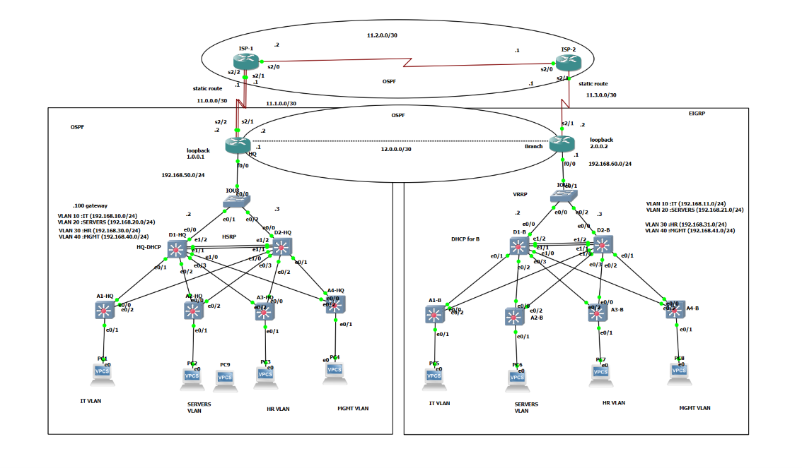

# README

# README

# Enterprise HQ + Branch Lab (GNS3) — HSRP/VRRP, OSPF/EIGRP, Dual-ISP, GRE over IPsec

A complete enterprise network built in GNS3 and designed around real production practices: redundant distribution layer, dual-homed WAN with automatic failover, per-ISP NAT, encrypted site-to-site tunnel, and a hardened Layer 2 access layer.

> Self-study project (CCNA / CCNP ENCOR level). All secrets in the configs are replaced with `<REDACTED>`.
> 

## Topology

> 
> 

```
                         +---------+  11.2.0.0/30  +---------+
                         |  ISP-1  |===============|  ISP-2  |
                         +---------+               +---------+
                 11.0.0.0/30 ||  || 11.1.0.0/30         || 11.3.0.0/30
                  (primary)  ||  || (backup)            ||
                         +---------+                +----------+
                         |   HQ    |   GRE/IPsec    |  Branch  |
                         | Router  |================| Router   |
                         +---------+  12.0.0.0/30   +----------+
                              | 192.168.50.0/24          | 192.168.60.0/24
                        +-----+-----+              +-----+-----+
                        |   IOU3    |              |   IOU1    |
                        +--+-----+--+              +--+-----+--+
                     +------+     +------+       +---+         +---+
                 +---+---+         +---+---+   +---+---+     +---+---+
                 | D1-HQ |=========| D2-HQ |   | D1-B  |=====| D2-B  |
                 | HSRP  |         | HSRP  |   | VRRP  |     | VRRP  |
                 +---+---+         +---+---+   +---+---+     +---+---+
                     |   \\       /   |             |   \\     /   |
                  A1-HQ  A2-HQ A3-HQ A4-HQ      A1-B  A2-B  A3-B  A4-B
```

## Devices

| Site | Device | Role |
| --- | --- | --- |
| HQ | HQ | Edge router: dual ISP, NAT, GRE/IPsec, OSPF ASBR |
| HQ | D1-HQ / D2-HQ | Distribution L3 switches, HSRP, inter-VLAN routing |
| HQ | A1–A4-HQ | Access switches (port-security, DHCP snooping, DAI) |
| HQ | IOU3 | Transit L2 switch (unconfigured) |
| Branch | Branch | Edge router: ISP-2, NAT, GRE/IPsec |
| Branch | D1-B / D2-B | Distribution L3 switches, VRRP, EIGRP |
| Branch | A1–A4-B | Access switches |
| Branch | IOU1 | Transit L2 switch (unconfigured) |
| WAN | ISP-1 / ISP-2 | Simulated providers, OSPF 2 |

## IP Plan

| Network | Purpose |
| --- | --- |
| 192.168.10.0/24 | HQ VLAN 10 |
| 192.168.20.0/24 | HQ VLAN 20 |
| 192.168.30.0/24 | HQ VLAN 30 |
| 192.168.40.0/24 | HQ VLAN 40 |
| 192.168.50.0/24 | HQ transit LAN (router ↔︎ distribution) |
| 192.168.11/21/31/41.0/24 | Branch VLANs 10/20/30/40 equivalents |
| 192.168.60.0/24 | Branch transit LAN |
| 11.0.0.0/30 | HQ ↔︎ ISP-1 (primary) |
| 11.1.0.0/30 | HQ ↔︎ ISP-1 (backup) |
| 11.2.0.0/30 | ISP-1 ↔︎ ISP-2 |
| 11.3.0.0/30 | ISP-2 ↔︎ Branch |
| 12.0.0.0/30 | GRE tunnel |
| 1.0.0.1 / 2.0.0.2 | HQ / Branch loopbacks (tunnel endpoints) |

## VLANs

| VLAN | Name / Use |
| --- | --- |
| 10, 20, 30, 40 | User / department VLANs |
| 999 | Native VLAN on all trunks (no hosts) |

## Key Design Decisions

| Area | Decision | Why |
| --- | --- | --- |
| First-hop redundancy | HSRP at HQ, VRRP at Branch | Demonstrates both; VRRP is the open standard, HSRP is Cisco-native |
| STP / HSRP alignment | STP root = HSRP active per VLAN (D1: 1,10,20,999; D2: 30,40) | Avoids suboptimal L2 paths that hairpin across the inter-distribution link |
| HSRP tracking | Track uplink line-protocol, decrement 60 | Active gateway moves when its uplink fails, so traffic never blackholes |
| OSPF (HQ) | MD5 auth, `passive-interface default`, router priority 255 on HQ, D1 priority 100 | Controls DR election, no adjacencies on user VLANs |
| Standby SVIs | `ip ospf cost 10` | Keeps the return path symmetric with HSRP active |
| EIGRP (Branch) | MD5 key-chain with time-based keys, offset-list | Key rollover without outage; offset-list makes the backup path a feasible successor |
| WAN failover | Floating static + IP SLA + track | Detects ISP failure by reachability, not just link state |
| NAT | Route-map based, one per egress ISP | Traffic is translated with the address of the interface it actually leaves through |
| Site-to-site | GRE over IPsec + OSPF 2 inside the tunnel | GRE carries routing; IPsec encrypts it |
| L2 security | DHCP snooping, DAI, BPDU guard, root guard, sticky port-security, errdisable recovery | Defense in depth at the access edge |
| Native VLAN | 999 everywhere, `nonegotiate` | Prevents VLAN hopping, keeps VLAN 1 out of the data path |

## Troubleshooting Scenario: Root Guard `Root\_Inconsistent`

**Symptom:** D2-B ports e0/2 and e0/3 go `\*ROOT\_Inc` and users behind them lose connectivity.

**Cause:** Native VLAN was changed to 999 on the distribution side only. The access switch kept native VLAN 1, so its untagged BPDUs were received by the distribution as VLAN 999 and looked like a superior root bridge. Root guard did exactly what it should.

**Diagnosis flow:**

1. `show spanning-tree inconsistentports` — shows which ports and which VLAN.
2. `show interfaces trunk` — compare native VLAN on both ends.
3. `show cdp neighbors` / CDP native VLAN mismatch log message.

**Fix:** `switchport trunk native vlan 999` on both ends of every trunk.

**Prevention:** Change native VLAN on both sides in the same maintenance window; verify with `show interfaces trunk` before and after.

## Verification Commands

```
show ip ospf neighbor            show ip eigrp neighbors
show standby brief               show vrrp brief
show ip route                    show ip sla statistics
show track                       show ip nat translations
show crypto isakmp sa            show crypto ipsec sa
show interfaces tunnel 1         show spanning-tree summary
show ip dhcp snooping binding    show ip arp inspection
show port-security               show errdisable recovery
show ntp status                  show interfaces trunk
```

Failover tests to run and capture :

1. Shut HQ → ISP-1 primary link: floating static takes over via 11.1.0.0/30, NAT switches to NAT-ISP2 path as configured.
2. Shut D1-HQ uplink: HSRP tracking moves active to D2-HQ.
3. Shut the Branch ISP link: tunnel drops, OSPF/EIGRP reconverge.
4. shut D1-B: VRRP master moves to D2-B.

## Known Limitations

- The switch image used does not support SSH, so switches use Telnet restricted by ACL and console only. Routers use SSHv2.
- ISPs run OSPF instead of BGP (simplification).
- Links through the IOU transit switches negotiate half duplex (IOU emulation artifact).
- EtherChannel was removed after causing dynamic-routing instability in the emulated environment.
- One DHCP server per site (no failover pair).

## Repository Layout

```
configs/
  hq/       HQ, D1-HQ, D2-HQ, A1..A4-HQ, IOU3
  branch/   Branch, D1-B, D2-B, A1..A4-B, IOU1
  isp/      ISP-1, ISP-2
docs/       topology image
```

## Security Note

Passwords, keys, and secrets are replaced by `<REDACTED>`. Use your own values when reproducing the lab.

## Tools

GNS3, Cisco IOSv/IOU images , Wireshark.